# calm-pets

Calm desktop pets for **[Codex](https://developers.openai.com/codex)** and the **[Orca](https://orca.dev)**
([source](https://github.com/stablyai/orca)) pet overlay, plus an Agent Skill, `calm-pet-designer`, that teaches your coding agent to
design, build and package more of them.

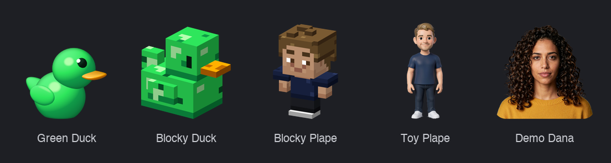

A pet sits next to your work all day, so these pets move calmly:
- held poses per state;
- long holds and quick blinks;
- motion mostly in the face;
- breathing only in the chest.

The HD versions stay crisp at Orca's Pet size 208.

## The pets

| Pet | Idle | States: idle · waiting · running · review |
|---|---|---|
| **Green Duck**: a classic rubber duck in mainframe-terminal green | 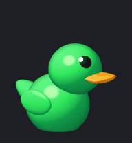 | 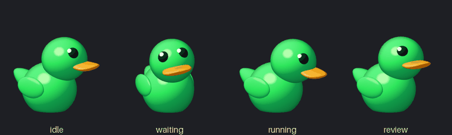 |
| **Blocky Duck**: the same duck as a block-game voxel toy | 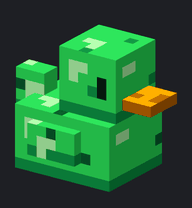 | 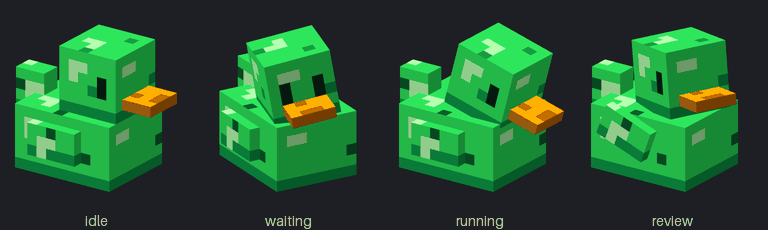 |
| **Blocky Plape**: a blocky chibi of the author, with a laptop when working | 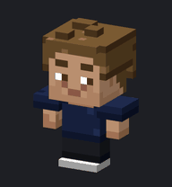 | 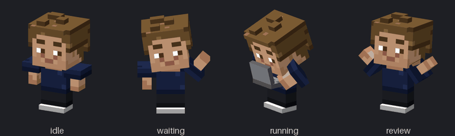 |
| **Toy Plape**: the author as a 3D toy figure | 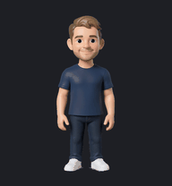 | 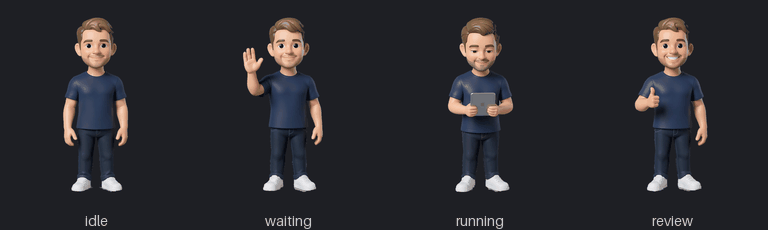 |
| **Demo Dana**: a realistic bust of an invented person ([how it was made](#from-a-photo)) |  | 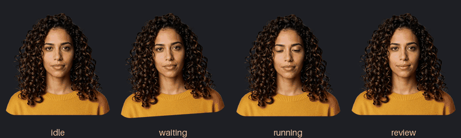 |

Every pet comes in two folders under [`pets/`](pets):

| Folder | Cells | For |
|---|---|---|
| `pets/<name>/` | 192x208 (standard) | Codex, and Orca at any size |
| `pets/<name>-hd/` | 384x416 | Orca at Pet size **208** or 104, where it is sharpest |

All frames of each pet, on dark:

<details><summary>Contact sheets</summary>

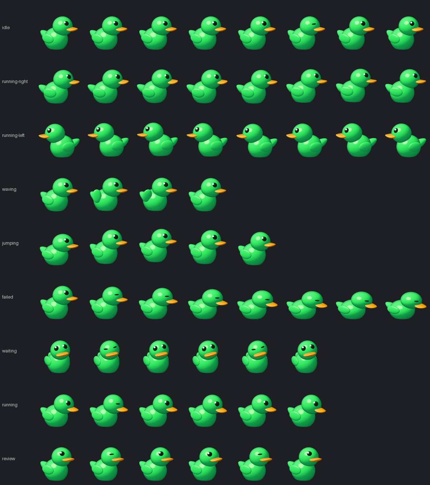
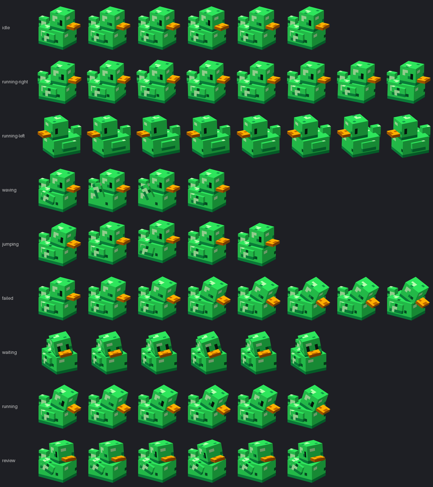

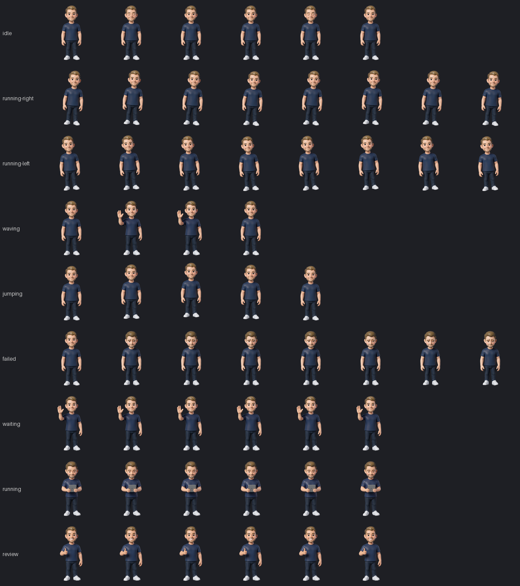
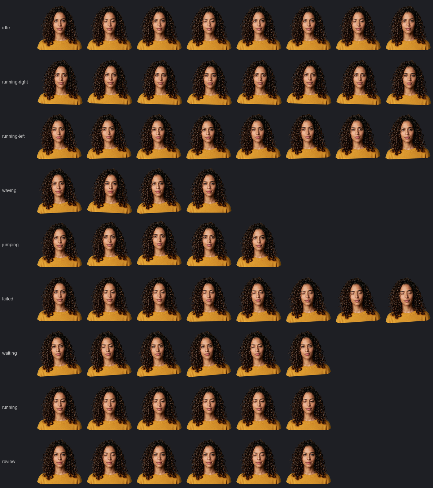

</details>

### From a photo

The skill can also turn one photo into a realistic pet, a 3D toy figure or a blocky chibi.
The photo is never regenerated as a whole. The pet keeps the person's face because only
small regions are inpainted through a soft mask:
- the eyes closed, for blinks;
- the eyes looking down, for working;
- a closed-mouth smile, for done.

A small head tilt is a plain rotation. Everything else stays pixel-identical. With a local
image model, the photo never leaves your machine.

Demo Dana does not exist. Her source portrait was generated from text, and every frame of
the pet was made from it with the same steps:


## Install a pet

Download a ZIP from [Releases](https://github.com/plavjanik/calm-pets/releases), or clone
the repo:

```sh
git clone https://github.com/plavjanik/calm-pets.git
```

**[Orca](https://orca.dev)**
1. Turn on Settings → Experimental → **Pet**.
2. In the status-bar Pet menu, choose **Import .codex-pet bundle…** and pick a folder, for
   example `pets/green-duck-hd`.
3. Restart Orca.
4. Set Pet menu → Size to **208** for HD pets.

**Codex**
```sh
mkdir -p "${CODEX_HOME:-$HOME/.codex}/pets"
cp -R calm-pets/pets/green-duck "${CODEX_HOME:-$HOME/.codex}/pets/"
```
Then choose it in Settings → Appearance → Pets, or with `/pet`.

## Install the skill

```sh
npx skills add plavjanik/calm-pets
```

The [skills CLI](https://github.com/vercel-labs/skills) installs the skill for Claude
Code, Codex, Cursor, OpenCode and other agents that read `SKILL.md`. Then ask your
agent something like *"make me a calm Codex pet of a sleepy cat"*.

The skill ([`skills/calm-pet-designer`](skills/calm-pet-designer)) contains:
- the format contract, both the Codex rules and the extra Orca rules;
- a motion recipe with real timings;
- four production tracks: a smooth 3D toy, blocky voxel, a likeness avatar with
  inpainting, and a generated cartoon;
- a review checklist;
- Python scripts (needing only Pillow) to pack, validate, downscale and preview bundles.

```sh
python3 skills/calm-pet-designer/scripts/validate_pet.py pets/green-duck --codex
python3 skills/calm-pet-designer/scripts/preview_pet.py pets/green-duck-hd --out /tmp/preview
```

## How it compares

Other skills on [skills.sh](https://skills.sh) make Codex pets too. This one is for when
you care about calm motion, crisp output in Orca, or keeping a photo private.

| Skill | How it makes the pet | Needs | Photo of you | Motion control | Output |
|---|---|---|---|---|---|
| **calm-pet-designer** (this repo) | Any art tool: 3D, voxel, inpainting or generation. Held poses after you pick a still. | Python + Pillow, and your art tool | Yes. Small inpainted regions, can run fully local. | Per-frame timings, a calm-motion recipe, a motion check in the validator | Standard 192x208 + HD 384x416 for Orca |
| [hatch-pet](https://github.com/openai/skills/tree/main/skills/.curated/hatch-pet) (OpenAI) | A base image + 9 generated row strips, sliced by scripts | Codex image generation (or an API key) | As a reference image | A fixed timing table | 192x208, installs to `~/.codex/pets` |
| [codex-pet-director](https://github.com/zixuanzhou0-ai/codex-pet-director) | Interview + confirmation images, then hands off to hatch-pet | As hatch-pet | Yes | As hatch-pet | As hatch-pet |
| [codex-pet](https://skills.sh/prime-skills/runcomfy-agent-skills/codex-pet) (RunComfy) | One image edit, then small transforms of that one pose | RunComfy account; the photo must be at a public URL | Yes, uploaded | 1-2 px shifts, blink | 192x208 |
| [codex-pet-maker](https://github.com/luyu2026/codex-pet-skill) | The whole sheet generated, then cleaned | Built-in image generation | Yes | None | 192x208 |

The validator's transparent-pixel residue check comes from hatch-pet. The question about
how close the likeness should be comes from codex-pet-director. For a cartoon pet generated
from a text idea, hatch-pet works well alongside this skill.

## Licence

- Code and skill text: [MIT](LICENSE).
- Green Duck, Blocky Duck and Demo Dana (an invented person) artwork: [CC BY 4.0](https://creativecommons.org/licenses/by/4.0/).
- Blocky Plape and Toy Plape show a real person. You may
  use them as your pet and share them unchanged with credit, but don't modify them or use
  them commercially
  ([CC BY-NC-ND 4.0](https://creativecommons.org/licenses/by-nc-nd/4.0/)).

See [ASSETS-LICENSE.md](ASSETS-LICENSE.md).
